# 🧑‍💻 Portfólio Profissional — Lucas Silva Borges

> [!NOTE]
> Website de portfólio profissional **bilíngue (PT/EN)** com apresentação pessoal, **linha do tempo de projetos** e experiências, com **front-end em React + Vite** e **back-end em Spring Boot**.
> Laboratório 01 da disciplina **DIAW — Desenvolvimento e Integração de Aplicações Web** (Engenharia de Software · PUC Minas).

<table>
  <tr>
    <td width="800px">
      <div align="justify">
        Este projeto é um <b>portfólio profissional</b> pensado para apresentar minha trajetória de forma <i>moderna</i>, <i>acessível</i> e <i>responsiva</i>. O sistema é dividido em duas partes: um <b>front-end em React + Vite</b> (SPA com rotas e troca de idioma em tempo real), hospedado na <b>Vercel</b>, e uma <b>API REST em Spring Boot</b>, hospedada no <b>Render</b>, que fornece os projetos e as experiências exibidos no site. Para atualizar o portfólio basta editar os arquivos JSON da API — o front-end busca os dados e monta a timeline sozinho.
      </div>
    </td>
    <td>
      <div align="center">
        
      </div>
    </td>
  </tr>
</table>

---

## 🚧 Status do Projeto


| Sprint | Entrega | Pontos | Situação |
| :--- | :--- | :---: | :---: |
| **Lab01S01** | Planejamento, wireframes, protótipo inicial, navegação e layout | 4 | ✅ |
| **Lab01S02** | Sobre Mim PT/EN, timeline dinâmica, Experiências, API Spring Boot integrada, responsividade | 4 | 🟡 em andamento |
| **Lab01S03** | Deploy (Vercel + Render), ajustes visuais, imagens/GIFs dos projetos e README final | 7 | ⏳ |

---

## 📚 Índice
- [Links Úteis](#-links-úteis)
- [Sobre o Projeto](#-sobre-o-projeto)
- [Funcionalidades Principais](#-funcionalidades-principais)
- [Protótipos (Wireframes)](#-protótipos-wireframes)
- [Tecnologias Utilizadas](#-tecnologias-utilizadas)
- [Arquitetura](#-arquitetura)
- [Instalação e Execução](#-instalação-e-execução)
- [Endpoints da API](#-endpoints-da-api)
- [Deploy](#-deploy)
- [Estrutura de Pastas](#-estrutura-de-pastas)
- [Demonstração](#-demonstração)
- [Testes](#-testes)
- [Documentações utilizadas](#-documentações-utilizadas)
- [Autores](#-autores)
- [Licença](#-licença)

---

## 🔗 Links Úteis
* 🌐 **Front-end (Vercel):** _em breve (Sprint 03)_
* ⚙️ **API (Render):** [portfolio-api-lucas.onrender.com/api/status](https://portfolio-api-lucas.onrender.com/api/status)
  > A instância gratuita "dorme" sem acesso; a primeira requisição pode levar até 1 minuto.
* 📂 **Código-fonte:** [`/portfolio`](./portfolio) (front-end) · [`/backend`](./backend) (API)
* 🎨 **Wireframes:** [`/docs/wireframes`](./docs/wireframes)

---

## 📝 Sobre o Projeto

- **Por que existe:** recrutadores e professores precisam ver, em poucos minutos, quem eu sou, o que já construí e como me encontrar. Um portfólio próprio reúne isso num lugar só, com links diretos para o código no GitHub.
- **Qual problema resolve:** os projetos da faculdade ficam espalhados em pastas de repositórios; o portfólio organiza esses trabalhos numa linha do tempo, com descrição, tecnologias, imagem e link para o repositório.
- **Contexto:** acadêmico — Laboratório 01 da disciplina DIAW (2º período de Engenharia de Software, PUC Minas) — mas pensado para continuar sendo usado profissionalmente depois.
- **Onde pode ser usado:** currículo, LinkedIn, candidaturas a estágio e apresentações.

---

## ✨ Funcionalidades Principais

- 🧭 **Menu de navegação** com rotas para Sobre Mim, Projetos e Experiências (com menu hambúrguer no celular).
- 🌐 **Bilíngue (PT/EN):** troca de idioma em tempo real, lembrando a escolha do visitante. A API também devolve os textos nos dois idiomas.
- 🙋 **Sobre Mim:** formação, área de atuação, interesses, objetivos e tecnologias.
- 🗓️ **Projetos em timeline:** vindos da API, ordenados do mais antigo ao mais recente, cada um com nome, descrição, tecnologias, link do GitHub e imagem/GIF.
- 💼 **Experiências:** vindas da API, com empresa/instituição, cargo ou atividade, período, tipo e descrição.
- ⏳ **Estados de carregamento e erro:** mensagens de "carregando", "nada por aqui" e botão "Tentar novamente" caso a API esteja fora do ar.
- 📱 **Responsivo e acessível:** layout mobile-first, link "pular para o conteúdo", foco visível, `aria-*` nos controles e respeito a `prefers-reduced-motion`.

---

## 🎨 Protótipos (Wireframes)

Wireframes de **média fidelidade** feitos antes da implementação. Os arquivos `.svg` em [`docs/wireframes`](./docs/wireframes) podem ser **arrastados direto para o Figma**, onde viram vetores editáveis.

| Sobre Mim | Projetos (timeline) |
| :---: | :---: |
| 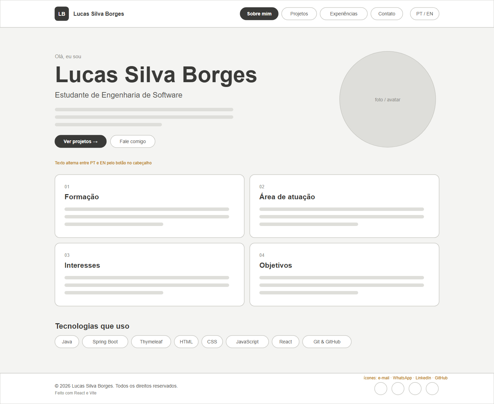 | 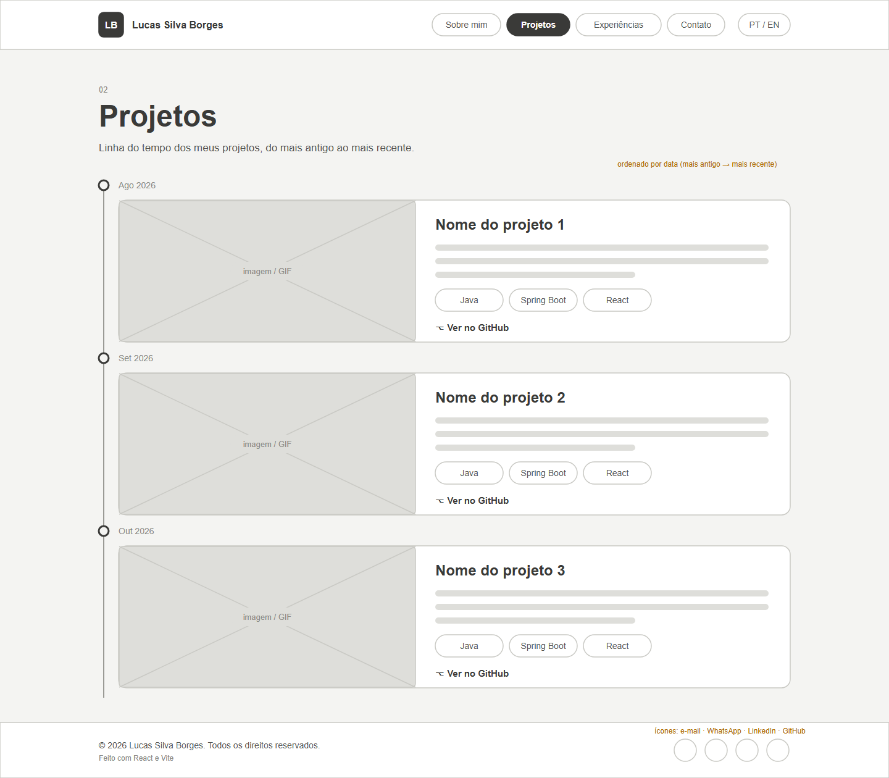 |
| **Experiências** | **Contato** |
| 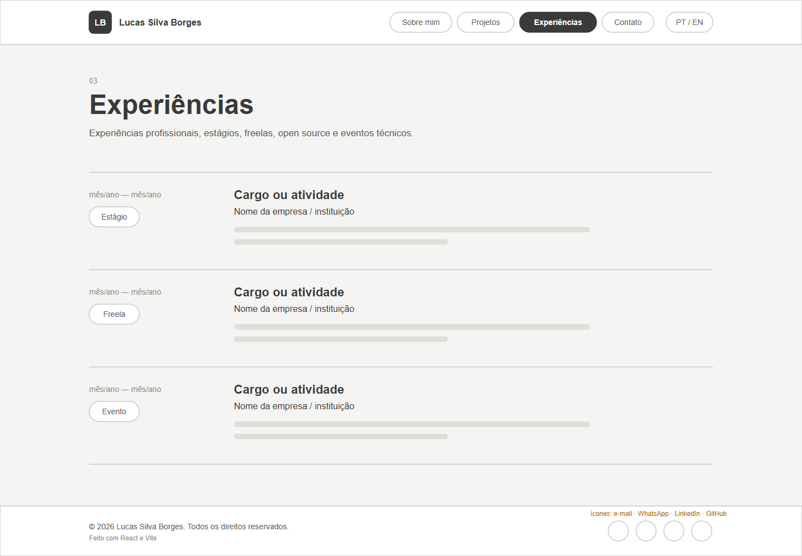 | 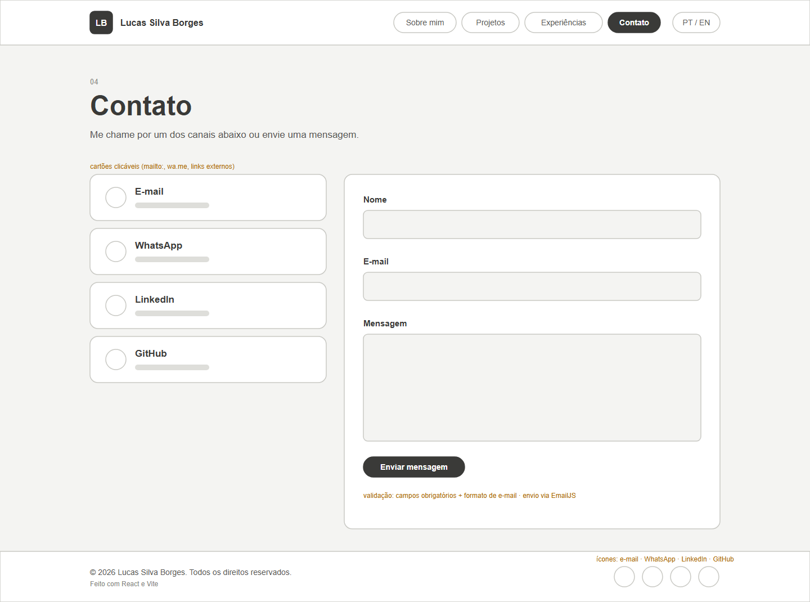 |

| Mobile — Sobre Mim e menu aberto |
| :---: |
| 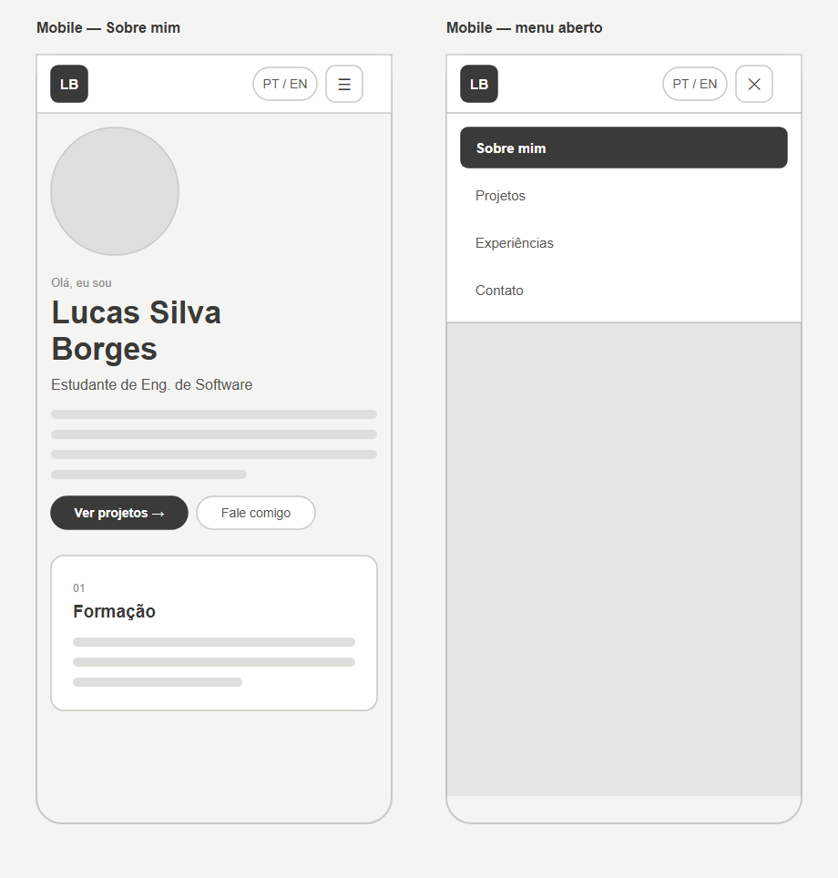 |

### Identidade visual

| Elemento | Escolha |
| :--- | :--- |
| Fundo | Grafite `#101114` com superfícies `#17191e` / `#1d2026` |
| Destaque | Âmbar `#ffb347` → laranja `#ff8a3d` (botões, links, timeline) |
| Títulos | **Space Grotesk** |
| Texto | **Inter** |
| Rótulos, datas e tags | **JetBrains Mono** — referência ao universo de código |

---

## 🛠 Tecnologias Utilizadas

### 💻 Front-end

* **Biblioteca:** React 19.3
* **Linguagem:** JavaScript (ES2022+) com JSX
* **Roteamento:** React Router 7.18
* **Estilização:** CSS puro com variáveis (design tokens) e media queries
* **Ícones:** React Icons 5.7
* **Gerenciamento de Estado:** Context API (idioma) + `useState` + hook próprio `useApi`
* **Comunicação com a API:** `fetch` nativo
* **Build Tool:** Vite 8.3
* **Lint:** Oxlint

### 🖥️ Back-end

* **Linguagem:** Java 21
* **Framework:** Spring Boot 4.1.1 (Spring Web MVC)
* **Build:** Maven (com Maven Wrapper `mvnw`)
* **Dados:** arquivos JSON em `src/main/resources/dados`, lidos com Jackson na inicialização
* **Testes:** JUnit 5 + MockMvc

### ⚙️ Infraestrutura

* **Front-end:** Vercel (hospedagem estática gratuita, deploy automático a cada push)
* **Back-end:** Render (Web Service gratuito com Docker)
* **Containerização:** Docker (`backend/Dockerfile`, build em duas etapas)
* **Versionamento:** Git + GitHub

### 📦 Dependências

**Front-end (`portfolio/package.json`)**

| Pacote | Versão | Tipo | Para que serve |
| :--- | :---: | :---: | :--- |
| `react` / `react-dom` | 19.3.0 | produção | Construção da interface |
| `react-router-dom` | 7.18.4 | produção | Rotas das páginas e menu ativo |
| `react-icons` | 5.7.0 | produção | Ícones (menu, seta, GitHub) |
| `vite` | 8.3.4 | dev | Servidor de desenvolvimento e build |
| `@vitejs/plugin-react` | 6.1.2 | dev | Suporte a JSX/React no Vite |
| `oxlint` | 1.87.0 | dev | Análise estática do código |

**Back-end (`backend/pom.xml`)**

| Dependência | Para que serve |
| :--- | :--- |
| `spring-boot-starter-webmvc` | API REST (Spring MVC + Tomcat embutido + Jackson) |
| `spring-boot-starter-webmvc-test` | Testes com JUnit 5 e MockMvc |

---

## 🏗 Arquitetura

O sistema segue o modelo **cliente-servidor**: o front-end é uma **SPA estática** servida pela Vercel e o back-end é uma **API REST** em Spring Boot no Render. O navegador baixa o site da Vercel e busca os dados (projetos e experiências) direto na API.

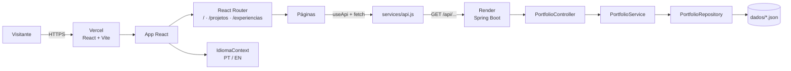

**Camadas do back-end**

| Camada | Classe | Responsabilidade |
| :--- | :--- | :--- |
| Controller | `PortfolioController` | Expõe os endpoints `/api/...` |
| Service | `PortfolioService` | Regras: ordenar a timeline, buscar projeto por id |
| Repository | `PortfolioRepository` | Lê `projetos.json` e `experiencias.json` |
| Model | `Projeto`, `Experiencia`, `Texto` | Records Java com os dados (textos em `pt`/`en`) |
| Config | `CorsConfig` | Libera o front-end (localhost e Vercel) para chamar a API |
| Exception | `TratadorDeErros` | Converte "projeto não encontrado" em resposta 404 |

**Decisões principais**

- **Conteúdo no back-end:** projetos e experiências ficam em JSON dentro da API; o front só exibe. Adicionar um projeto à timeline é adicionar um objeto ao `projetos.json`.
- **Timeline ordenada na API:** o `PortfolioService` ordena pelo campo `data` (`AAAA-MM`), então a ordem no arquivo não importa.
- **JSON em vez de banco de dados:** o conteúdo muda pouco e é editado por mim, então um banco seria complexidade sem ganho. A camada `Repository` isola essa escolha — trocar por JPA depois não mexe no controller.
- **Textos bilíngues no próprio dado:** cada texto vem como `{ "pt": ..., "en": ... }` e o front escolhe conforme o idioma ativo.
- **Internacionalização com Context API:** o `IdiomaProvider` guarda o idioma (salvo no `localStorage`) e expõe `t` (textos fixos) e `alternar()`.
- **Hook `useApi`:** centraliza carregando/erro/dados e o "tentar novamente", reaproveitado nas páginas de Projetos e Experiências.
- **CORS configurável:** as origens liberadas vêm da variável `CORS_ORIGENS`, então a mesma API serve o ambiente local e a Vercel.
- **Trade-off:** no plano gratuito, o Render "dorme" depois de um tempo sem acesso e a primeira requisição pode levar cerca de 1 minuto. O front avisa isso na mensagem de carregamento.

---

## 🔧 Instalação e Execução

### Pré-requisitos

* **Java JDK:** 21 ou superior (back-end)
* **Node.js:** v20.19+ ou v22.12+ (front-end, testado com v24)
* **npm**
* Maven **não** precisa estar instalado — o projeto usa o Maven Wrapper (`mvnw`)

### 🔑 Variáveis de Ambiente

**Back-end (Spring Boot)**

| Variável | Descrição | Padrão |
| :--- | :--- | :--- |
| `PORT` | Porta da API (o Render define sozinho) | `8080` |
| `CORS_ORIGENS` | Origens liberadas, separadas por vírgula | `http://localhost:5173` |

**Front-end (React, Vite)** — arquivo `portfolio/.env.local` (opcional localmente)

| Variável | Descrição | Padrão |
| :--- | :--- | :--- |
| `VITE_API_URL` | URL base da API | `http://localhost:8080` |

### 📦 Instalação de Dependências

```bash
git clone https://github.com/LucasSilvaBorges02/diaw.git
cd "diaw/TRABALHO/TRABALHO PRÁTICO 1"
```

Back-end:

```bash
cd backend
./mvnw clean install
```

Front-end:

```bash
cd portfolio
npm install
```

### ⚡ Como Executar

Em **dois terminais separados**:

#### Terminal 1: Back-end (Spring Boot)

```bash
cd backend
./mvnw spring-boot:run
```

⚙️ *A API estará disponível em **http://localhost:8080** (teste em http://localhost:8080/api/status).*

> No Windows (PowerShell/CMD) use `mvnw.cmd` no lugar de `./mvnw`.

#### Terminal 2: Front-end (React, Vite)

```bash
cd portfolio
npm run dev
```

🎨 *O site estará disponível em **http://localhost:5173**.*

Outros comandos do front-end:

| Comando | O que faz |
| :--- | :--- |
| `npm run build` | Gera a versão de produção em `dist/` |
| `npm run preview` | Serve a pasta `dist/` localmente para conferir o build |
| `npm run lint` | Roda o Oxlint |

### ✏️ Como editar o conteúdo

| Quero mudar… | Arquivo |
| :--- | :--- |
| Projetos da timeline | `backend/src/main/resources/dados/projetos.json` |
| Experiências | `backend/src/main/resources/dados/experiencias.json` |
| Nome, foto, tecnologias | `portfolio/src/data/perfil.js` |
| Textos de Sobre Mim e da interface (PT e EN) | `portfolio/src/i18n/textos.js` |
| Imagens/GIFs dos projetos | `portfolio/public/projetos/` (e referenciar no campo `imagem` do JSON) |

Exemplo de projeto no `projetos.json`:

```json
{
  "id": "api-clima",
  "data": "2026-08",
  "nome": "API REST de Clima",
  "descricao": { "pt": "Descrição em português.", "en": "Description in English." },
  "tecnologias": ["Java", "Spring Boot"],
  "github": "https://github.com/LucasSilvaBorges02/diaw",
  "imagem": "/projetos/api-clima.gif"
}
```

---

## 📡 Endpoints da API

| Método | Endpoint | Descrição | Resposta |
| :---: | :--- | :--- | :--- |
| GET | `/api/status` | Verifica se a API está no ar | `{"status":"ok"}` |
| GET | `/api/projetos` | Lista os projetos do mais antigo ao mais recente | `200` + array |
| GET | `/api/projetos/{id}` | Busca um projeto pelo id | `200` ou `404 {"erro": ...}` |
| GET | `/api/experiencias` | Lista as experiências | `200` + array |

Exemplo:

```bash
curl http://localhost:8080/api/experiencias
```

```json
[
  {
    "id": "puc-minas",
    "tipo": "academico",
    "empresa": "PUC Minas",
    "cargo": { "pt": "Graduação em Engenharia de Software", "en": "B.Sc. in Software Engineering" },
    "periodo": { "pt": "2026 — atual", "en": "2026 — present" },
    "descricao": null
  }
]
```

---

## 🚀 Deploy

### 1. Back-end no Render

1. Em [dashboard.render.com](https://dashboard.render.com/), clique em **New → Web Service** e informe o repositório `https://github.com/LucasSilvaBorges02/diaw`.
2. **Language:** `Docker`. **Root Directory:** deixe vazio.
3. Em **Advanced → Dockerfile Path**, use `./portfolio-api.Dockerfile` (arquivo na raiz do repositório).
   > O Render não aceita espaço nem acento no Root Directory, então `TRABALHO PRÁTICO 1` não pode ser usado direto. O `portfolio-api.Dockerfile` copia a pasta `backend/` e faz o build. O `backend/Dockerfile` continua servindo para rodar com Docker localmente (`docker build backend`).
4. **Health Check Path:** `/api/status`. **Instance Type:** `Free`.
5. Em **Environment**, adicione `CORS_ORIGENS` com a URL da Vercel (ex.: `https://meu-portfolio.vercel.app`).
6. Clique em **Deploy** e teste `https://<sua-api>.onrender.com/api/status`.

### 2. Front-end na Vercel

1. Em [vercel.com/new](https://vercel.com/new), importe o repositório `LucasSilvaBorges02/diaw`.
2. **Root Directory:** `TRABALHO/TRABALHO PRÁTICO 1/portfolio`
3. A Vercel detecta o Vite sozinha (build `npm run build`, saída `dist`).
4. Em **Environment Variables**, adicione `VITE_API_URL` com a URL do Render (ex.: `https://<sua-api>.onrender.com`).
5. Clique em **Deploy**. A cada `git push` na `main`, front e back são atualizados automaticamente.

O arquivo `portfolio/vercel.json` redireciona todas as rotas para o `index.html`, para que links como `/projetos` funcionem ao recarregar a página.

---

## 📂 Estrutura de Pastas

```
TRABALHO PRÁTICO 1/
├── README.md                         # 📘 Este documento
├── docs/
│   ├── wireframes/                   # 🎨 Wireframes (.svg editável no Figma + .png)
│   └── prints/                       # 🖼️ Capturas de tela
│
├── backend/                          # 📁 API REST (Spring Boot)
│   ├── Dockerfile                    # 🐳 Build da imagem usada no Render
│   ├── mvnw / mvnw.cmd / .mvn/       # 🛠️ Maven Wrapper
│   ├── pom.xml                       # 📦 Dependências e build
│   └── src/
│       ├── main/java/br/pucminas/diaw/portfolio/
│       │   ├── PortfolioApiApplication.java  # 🚪 Classe principal
│       │   ├── controller/           # 🎮 PortfolioController (endpoints)
│       │   ├── service/              # ⚙️ PortfolioService (regras)
│       │   ├── repository/           # 🗄️ PortfolioRepository (leitura dos JSON)
│       │   ├── model/                # 🧬 Projeto, Experiencia, Texto
│       │   ├── config/               # 🔧 CorsConfig
│       │   └── exception/            # 💥 TratadorDeErros e exceções
│       ├── main/resources/
│       │   ├── application.properties  # ⚙️ Porta e CORS
│       │   └── dados/                # 🗂️ projetos.json e experiencias.json
│       └── test/java/...             # 🧪 Testes dos endpoints (MockMvc)
│
└── portfolio/                        # 📁 Front-end (React + Vite)
    ├── .env.example                  # 🧩 VITE_API_URL
    ├── index.html                    # 📄 HTML base, fontes e metadados
    ├── vercel.json                   # ☁️ Rewrite das rotas para a SPA
    ├── package.json                  # 📦 Dependências e scripts
    ├── public/
    │   ├── favicon.svg               # 🏷️ Logo "LB"
    │   └── projetos/                 # 🖼️ Imagens/GIFs dos projetos
    └── src/
        ├── main.jsx                  # 🚪 Ponto de entrada
        ├── App.jsx                   # 🧭 Definição das rotas
        ├── components/               # 🧱 Header, Footer, Layout, TituloPagina, EstadoApi
        ├── pages/                    # 📄 Sobre, Projetos, Experiencias, NaoEncontrada
        ├── hooks/                    # 🎣 useApi (carregando / erro / dados)
        ├── services/                 # 🔌 api.js (chamadas à API Spring Boot)
        ├── data/                     # 🗂️ perfil.js (nome, foto, tecnologias)
        ├── i18n/                     # 🌎 IdiomaContext.jsx e textos.js (PT/EN)
        └── styles/                   # 🎨 global.css (tokens, layout e responsividade)
```

---

## 🎥 Demonstração

Protótipo navegável rodando localmente.

### 🌐 Desktop

| Sobre Mim | Projetos | Experiências |
| :---: | :---: | :---: |
| 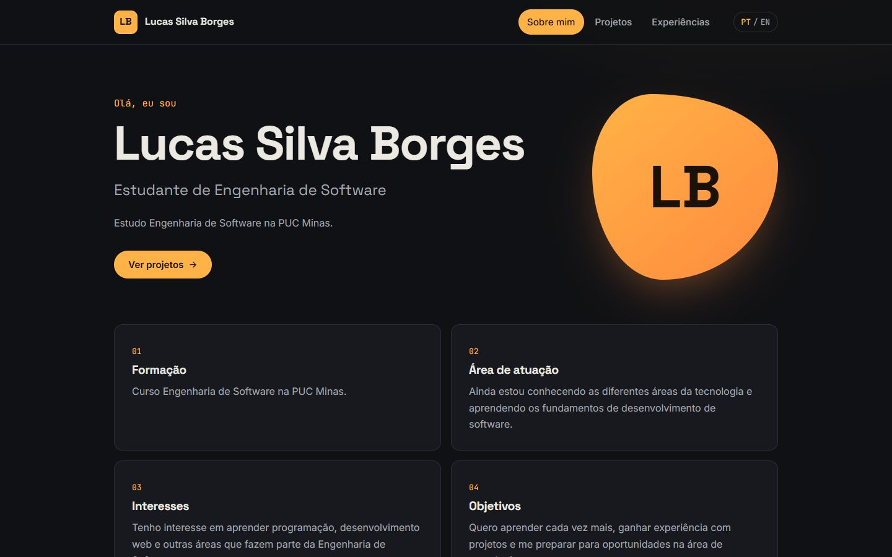 | 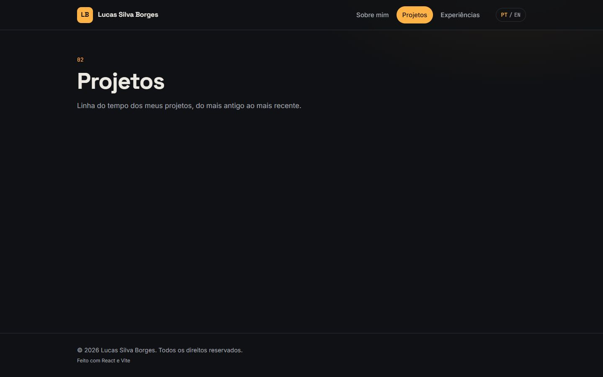 | 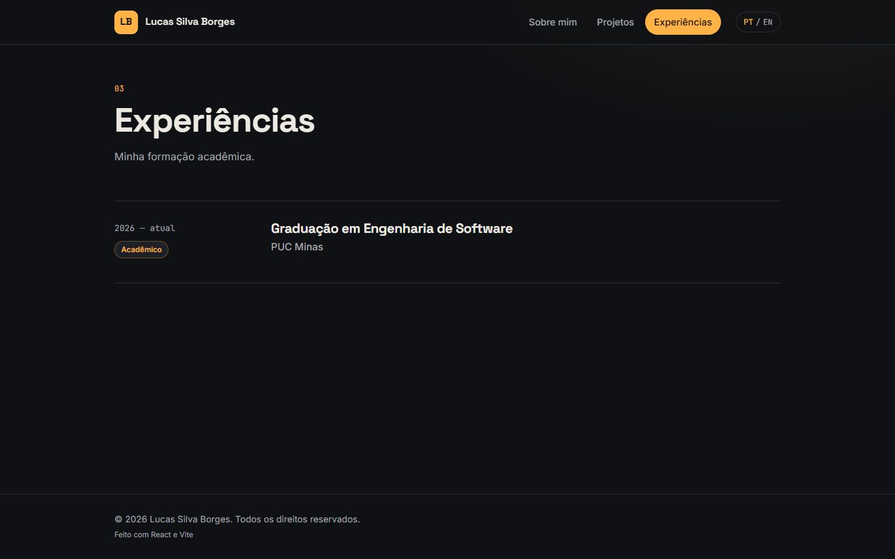 |

### 📱 Mobile

| Sobre Mim | Projetos | Menu |
| :---: | :---: | :---: |
| 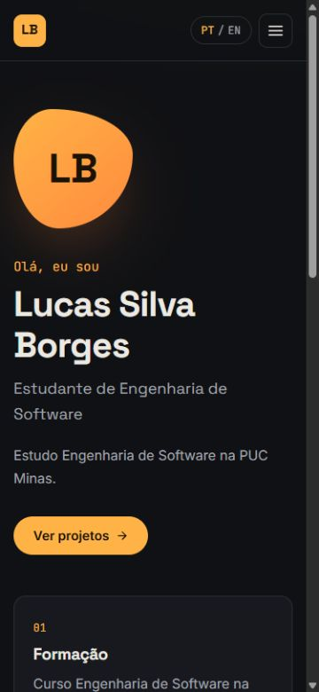 | 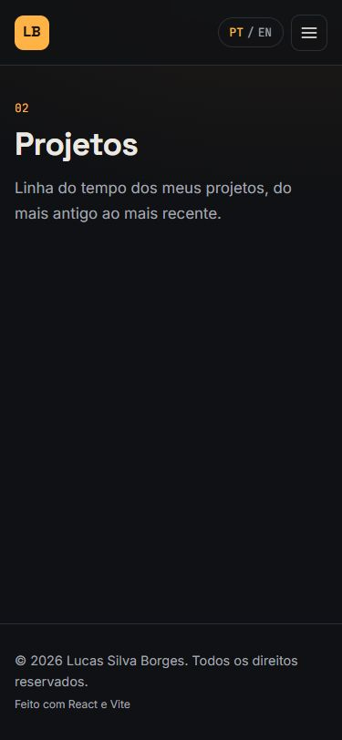 | 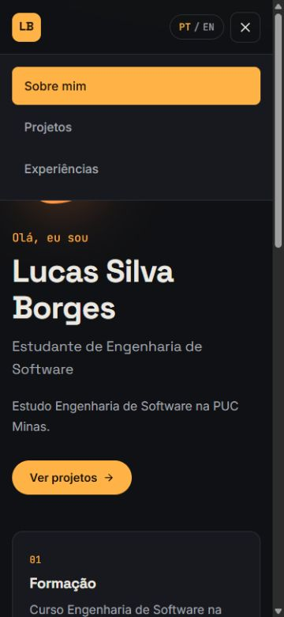 |

---

## 🧪 Testes

Testes de integração dos endpoints da API (status, listagem de projetos, 404 de projeto inexistente, experiências bilíngues e CORS):

```bash
cd backend
./mvnw test
```

*Ferramentas: JUnit 5 + MockMvc (Spring Boot Test).*

---

## 🔗 Documentações utilizadas

* 📖 [Documentação oficial do **React**](https://react.dev/reference/react)
* 📖 [Guia do **Vite**](https://vite.dev/guide/)
* 📖 [**React Router**](https://reactrouter.com/)
* 📖 [**Spring Boot** — documentação de referência](https://docs.spring.io/spring-boot/)
* 📖 [**Spring Initializr**](https://start.spring.io/)
* 📖 [**Render** — deploy com Docker](https://render.com/docs/docker)
* 📖 [**Vercel** — deploy de projetos Vite](https://vercel.com/docs/frameworks/frontend/vite)

---

## 👥 Autores

| 👤 Nome | :octocat: GitHub |
|---------|-----------------|
| Lucas Silva Borges | [@LucasSilvaBorges02](https://github.com/LucasSilvaBorges02) |

---

## 🙏 Agradecimentos

* [**Engenharia de Software PUC Minas**](https://www.instagram.com/engsoftwarepucminas/) — pelo apoio institucional e estrutura acadêmica.
* [**Prof. Dr. João Paulo Aramuni**](https://github.com/joaopauloaramuni) — pela proposta do laboratório e pelo template de README.

---

## 📄 Licença

Este projeto é distribuído sob a **Licença MIT**.
