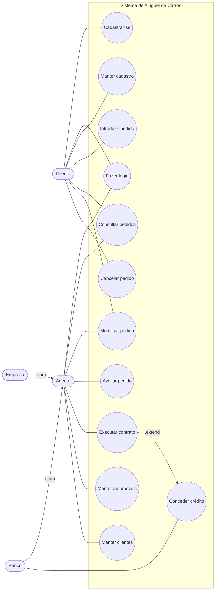
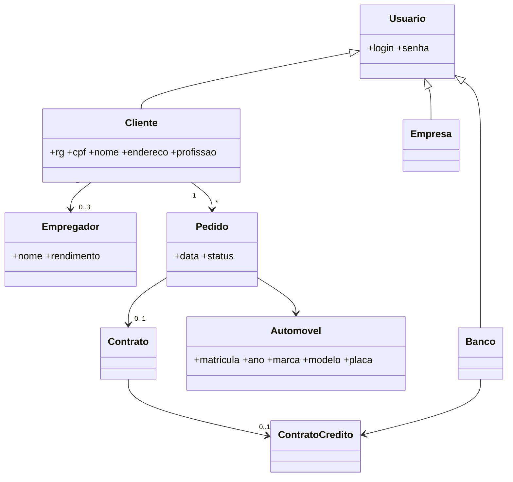
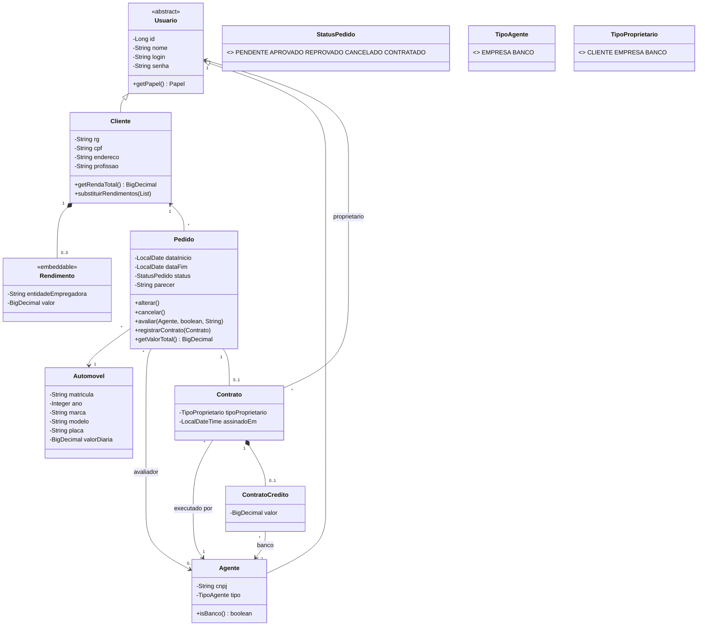
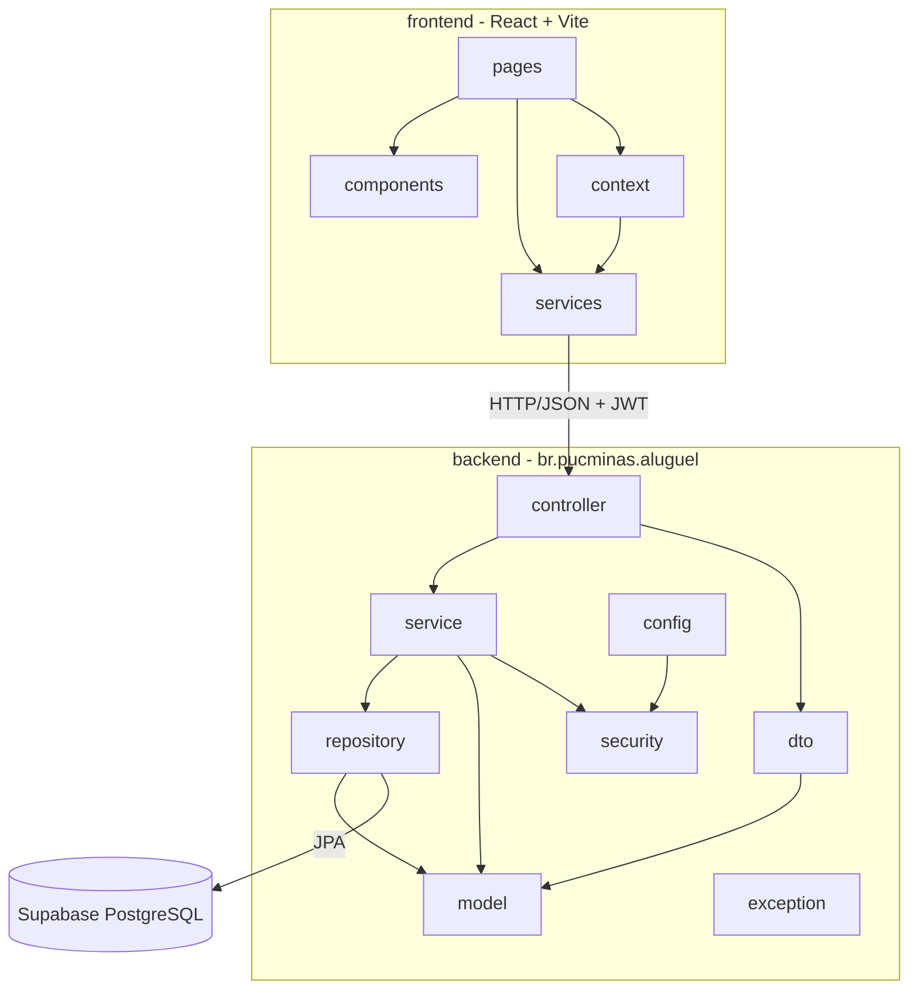

# Modelos UML

## 1. Diagrama de Casos de Uso

## 2. Diagrama de Classes

### Versão 1 (modelo inicial)

### Versão 2 (final, igual ao código)

**O que mudou da v1 para a v2**

- `Empresa` e `Banco` viraram uma classe só, `Agente`, com o enum `TipoAgente`: os dois fazem as mesmas coisas, só o crédito é exclusivo do banco.
- `Empregador` virou `Rendimento` (embutido no cliente, no máximo 3).
- O nome passou para `Usuario`, porque agentes também têm nome.
- `Automovel` ganhou `valorDiaria` para o agente conseguir analisar o valor do pedido.
- `Contrato` guarda em nome de quem o carro fica (`TipoProprietario` + `proprietario`).

## 3. Diagrama de Pacotes (visão lógica)

